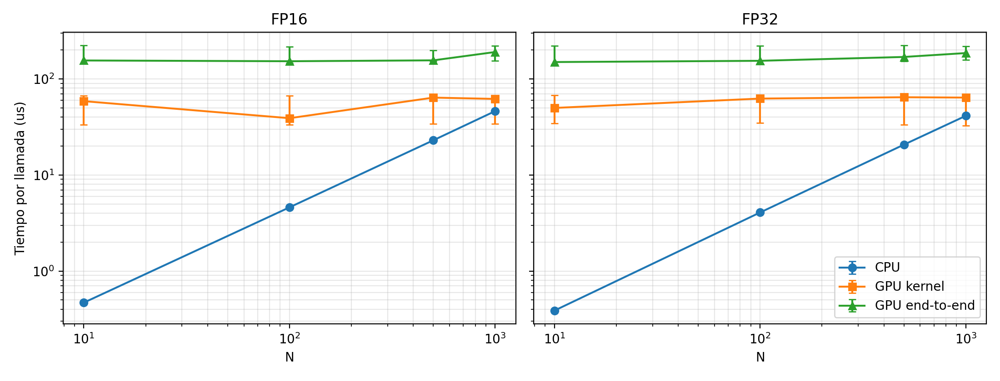
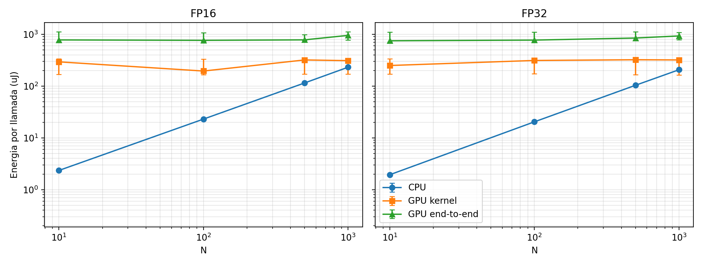
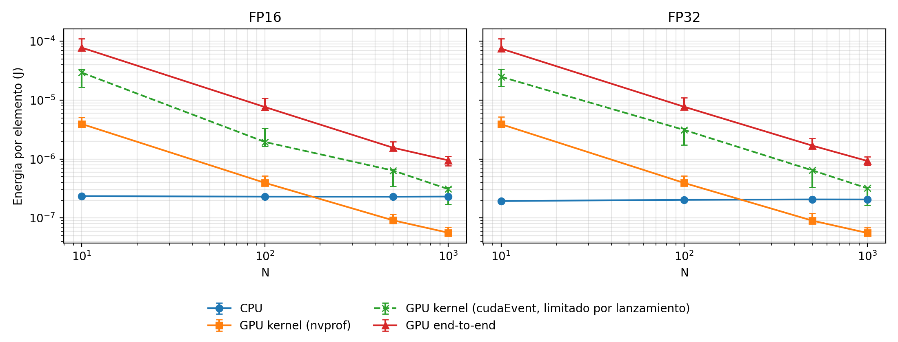
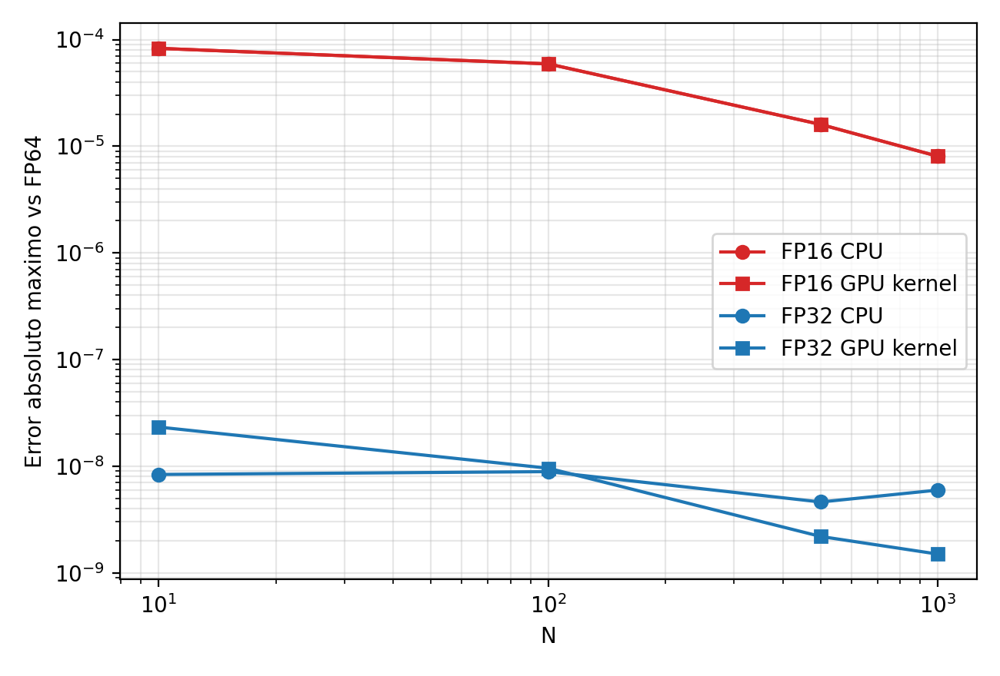
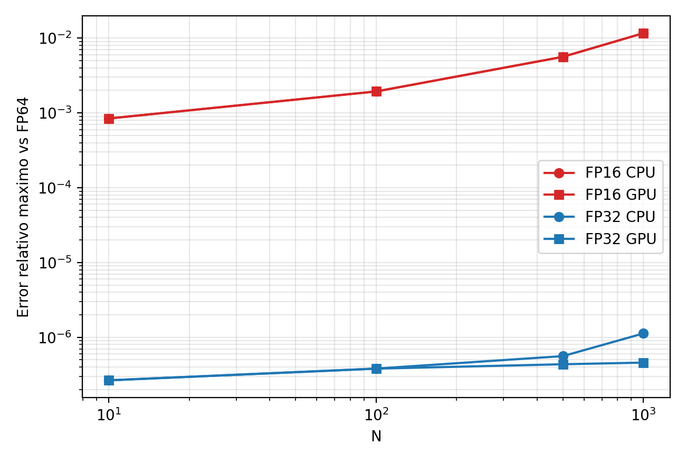

# Laboratorio Semana 13: Softmax en CPU, GPU (Jetson Nano) y FPGA (KV260)

EL5859 Computación Heterogénea, II Semestre 2026, Grupo 4. Softmax estable de un vector de N ≤ 1024 elementos en FP16 y FP32.
Integrantes: Gonzalo Alpízar Salas, Gerson Adrián Cordero Zúñiga, Nicole Irina Corrales Rodríguez, Keilin Loáisiga Téllez

| Carpeta | Contenido |
|---|---|
| `CPU/` | `softmax_cpu.cpp`, `cpu_results.csv` (datos crudos de la función), `programa_completo_cpu.csv` (datos crudos del programa completo) |
| `GPU/` | `softmax_cuda.cu`, `gpu_results.csv` (datos crudos) |
| `GPU/profiler/` | Salidas de `nvprof` y `nvprof_kernel.csv` (resumen del tiempo de kernel) |
| `FPGA/` | HLS para la KV260 (a cargo del compañero; ver sección 9) |
| `resultados/figuras/` | Figuras de tiempo, energía y error |

## 1. Plataforma y condiciones

Las condiciones se fijaron para todas las mediciones de CPU y GPU. Se obtuvieron con `nvpmodel -q`, `jetson_clocks --show` y `tegrastats`.

| Parámetro | Valor |
|---|---|
| Placa | NVIDIA Jetson Nano 2GB Developer Kit (acceso remoto por SSH) |
| Software | JetPack 4.x, Ubuntu 18.04, kernel 4.9.253-tegra, g++ 7.5.0, CUDA 10.2 |
| Modo de potencia | 5W (ID 1) |
| Núcleos activos | 2 (cpu0 y cpu1 en línea; cpu2 y cpu3 apagados) |
| Frecuencia CPU | 921.6 MHz fija |
| Frecuencia GPU | 614.4 MHz fija |
| Memoria (EMC) | 1600 MHz |
| Temperatura | ≈ 26–29 °C (tegrastats) |


**Lectura de potencia: alcance.** No hay lectura de potencia de la placa. `tegrastats` no reporta rieles de potencia, el driver `ina3221x` no tiene dispositivos, no hay dispositivos `iio`, `hwmon` solo expone el ventilador y los escaneos I2C no encontraron sensores. Tampoco hay acceso físico para medir con instrumentos. Por indicación del profesor se usó **P = 5 W (modo 5W) como potencia de referencia** y `E = P · t`. **La energía reportada no es una medición**: es el tiempo por 5 W, y por eso ordena las plataformas igual que el tiempo.

## 2. Datos y verificación

- Vector de entrada: `std::mt19937` con semilla 22 y `uniform_real_distribution<double>(-4, 4)`, generado en double. CPU, GPU y FPGA usan el mismo vector.
- Referencia: softmax en FP64 con `std::exp`, calculada con el vector original en double (antes de convertir), de modo que el error incluye el redondeo de la entrada.
- En cada ejecución se verifica que la suma sea ≈ 1, que todas las salidas estén en [0, 1] y que el argmax coincida con la referencia. Se reportan error absoluto y relativo máximos contra FP64.
- Forma estable: `softmax(x) = softmax(x − max(x))`.

## 3. Compilación y comandos

```bash
# Modo de potencia y relojes
sudo nvpmodel -q
sudo env "PATH=$PATH" jetson_clocks

# CPU
g++ -O3 -std=c++17 -march=native CPU/softmax_cpu.cpp -o softmax_cpu -lm
./softmax_cpu --precision fp16 --n 100 --reps 10000
./softmax_cpu --precision fp32 --n 100 --reps 10000

# GPU
nvcc -O3 -std=c++14 GPU/softmax_cuda.cu -o softmax_cuda
./softmax_cuda --precision fp16 --n 100 --reps 10000 --measure kernel
./softmax_cuda --precision fp16 --n 100 --reps 10000 --measure end-to-end

# Perfilador de CUDA (requiere sudo y PATH)
sudo env "PATH=$PATH" nvprof ./softmax_cuda --precision fp32 --n 1000 --reps 1000 --measure kernel
```

Cada ejecución agrega 5 filas a `cpu_results.csv` o `gpu_results.csv`. Para los `nvprof` se corrió, para fp16 y fp32 y los N indicados, `--reps 1000` con la salida de `nvprof` redirigida (stderr) a `GPU/profiler/nvprof_<precisión>_n<N>_<modo>.txt`. Los casos de kernel cubren N = 10, 100, 500 y 1000, y los de end-to-end N = 10 y 1000.
## 4. Protocolo de medición

- **Una función, una medición:** 1 lote de calentamiento descartado y luego **5 lotes de R llamadas** (R = `--reps`); se guarda el promedio por llamada de cada lote.
- **Repeticiones R:** CPU 2 000 000 / 250 000 / 50 000 / 25 000 (N = 10 / 100 / 500 / 1000); GPU modo kernel 20 000; GPU end-to-end 2 000.
- **10 procesos independientes** por combinación (precisión × N × medida). Cada proceso aporta 5 filas al CSV. Se reporta la **mediana de las medianas por proceso**, y como dispersión el mínimo y el máximo de esas medianas.
- **CPU, dos pruebas:** (a) la función, como arriba; (b) el **programa completo**, midiendo el proceso entero con `date +%s%N` por fuera, 10 corridas por configuración, con `--reps 1` (costo fijo) y `--reps 10000`.
- **GPU, dos tiempos:** (a) kernel y (b) end-to-end (copia H2D, lanzamiento, sincronización y copia D2H) con `steady_clock`. El modo `kernel` usa eventos CUDA, pero ver la limitación de la sección 5.

## 5. Decisiones y limitaciones documentadas

**FP16 en la CPU.** Se usa `__fp16` (GCC ARM) solo como formato de almacenamiento. El Cortex-A57 (ARMv8.0) no tiene aritmética FP16 nativa, y con g++ 7.5.0 `std::exp(__fp16)` devuelve `float` (`sizeof` = 4, verificado en la placa). Por eso el máximo, la exponencial y la suma se calculan en `float` y solo la entrada y la salida se redondean a 16 bits. Es la conversión a FP32 que permite el enunciado, documentada. En la GPU, el kernel usa `__half` para entrada/salida y calcula en `float` de la misma forma.

**La medición "kernel" con `cudaEvent` está limitada por el lanzamiento.** Esa medición dio 33–67 µs por llamada, casi independiente de N y muy variable. Al correr `nvprof` apareció que el kernel dura solo **7.8–11.3 µs**. Un kernel **vacío** lanzado igual (5 lotes de 20 000 lanzamientos) costó **≈ 43 µs por lanzamiento**, de modo que la GPU espera a que la CPU de la Jetson (Cortex-A57 a 921.6 MHz) encole cada kernel. Por eso, para el **tiempo de kernel** se usa `nvprof` (relojes de la GPU), y el modo `cudaEvent` se muestra aparte como medición limitada por lanzamiento. Los valores de `nvprof` son el promedio de 6001 llamadas bajo el perfilador y con la GPU a 614.4 MHz fija; su mín–máx corresponde a llamadas individuales.


**Variabilidad.** Las medianas por proceso del modo `cudaEvent` van de ≈ 33 a 67 µs; es la dispersión que se grafica en la serie discontinua.

## 6. Resultados

Potencia = 5 W (referencia). `E (µJ) = 5 · t (µs)` y `J/elem = E · 1e-6 / N`. "GPU kernel" es el tiempo de `nvprof`; "GPU e2e" es el end-to-end. El error máximo es el absoluto contra FP64. Las filas de KV260 las completa el compañero de HLS.

### FP32

| Plataforma | N | Tiempo (µs) | Potencia (W) | Energía (µJ) | J/elem | Error máx. |
|---|---|---|---|---|---|---|
| CPU | 10 | 0.388 | 5 | 1.94 | 1.94e-7 | 8.36e-9 |
| CPU | 100 | 4.072 | 5 | 20.4 | 2.04e-7 | 8.89e-9 |
| CPU | 500 | 20.674 | 5 | 103.4 | 2.07e-7 | 4.61e-9 |
| CPU | 1000 | 41.258 | 5 | 206.3 | 2.06e-7 | 5.97e-9 |
| GPU kernel | 10 | 7.811 | 5 | 39.1 | 3.91e-6 | 2.33e-8 |
| GPU kernel | 100 | 7.861 | 5 | 39.3 | 3.93e-7 | 9.57e-9 |
| GPU kernel | 500 | 9.023 | 5 | 45.1 | 9.02e-8 | 2.19e-9 |
| GPU kernel | 1000 | 11.133 | 5 | 55.7 | 5.57e-8 | 1.50e-9 |
| GPU e2e | 10 | 149.7 | 5 | 748.5 | 7.49e-5 | 2.33e-8 |
| GPU e2e | 100 | 154.2 | 5 | 771.0 | 7.71e-6 | 9.57e-9 |
| GPU e2e | 500 | 169.1 | 5 | 845.5 | 1.69e-6 | 2.19e-9 |
| GPU e2e | 1000 | 185.6 | 5 | 928.0 | 9.28e-7 | 1.50e-9 |
| KV260 | 10 / 100 / 500 / 1000 | pendiente (HLS) | | | | |

### FP16

| Plataforma | N | Tiempo (µs) | Potencia (W) | Energía (µJ) | J/elem | Error máx. |
|---|---|---|---|---|---|---|
| CPU | 10 | 0.469 | 5 | 2.35 | 2.35e-7 | 8.28e-5 |
| CPU | 100 | 4.607 | 5 | 23.0 | 2.30e-7 | 5.92e-5 |
| CPU | 500 | 22.956 | 5 | 114.8 | 2.30e-7 | 1.60e-5 |
| CPU | 1000 | 46.223 | 5 | 231.1 | 2.31e-7 | 8.05e-6 |
| GPU kernel | 10 | 7.877 | 5 | 39.4 | 3.94e-6 | 8.28e-5 |
| GPU kernel | 100 | 7.891 | 5 | 39.5 | 3.95e-7 | 5.92e-5 |
| GPU kernel | 500 | 9.133 | 5 | 45.7 | 9.13e-8 | 1.60e-5 |
| GPU kernel | 1000 | 11.253 | 5 | 56.3 | 5.63e-8 | 8.05e-6 |
| GPU e2e | 10 | 155.4 | 5 | 777.0 | 7.77e-5 | 8.28e-5 |
| GPU e2e | 100 | 152.6 | 5 | 763.0 | 7.63e-6 | 5.92e-5 |
| GPU e2e | 500 | 155.9 | 5 | 779.5 | 1.56e-6 | 1.60e-5 |
| GPU e2e | 1000 | 190.4 | 5 | 952.0 | 9.52e-7 | 8.05e-6 |
| KV260 | 10 / 100 / 500 / 1000 | pendiente (HLS) | | | | |

Las tablas muestran la mediana de las medianas de 10 procesos; los rangos mín–máx están en las barras de error de las figuras.

### Medición del kernel con `cudaEvent` (limitada por lanzamiento, mediana en µs)

| Precisión | N = 10 | N = 100 | N = 500 | N = 1000 |
|---|---|---|---|---|
| FP16 | 58.6 | 39.0 | 63.9 | 61.9 |
| FP32 | 49.8 | 62.4 | 64.4 | 63.9 |

### CPU: programa completo (mediana de 10 corridas, µs)

| Precisión | N | `--reps 1` | `--reps 10000` |
|---|---|---|---|
| FP16 | 10 | 9209 | 37 763 |
| FP16 | 100 | 9400 | 286 479 |
| FP16 | 500 | 9880 | 1 390 031 |
| FP16 | 1000 | 10 502 | 2 774 636 |
| FP32 | 10 | 9326 | 32 943 |
| FP32 | 100 | 9433 | 254 341 |
| FP32 | 500 | 9752 | 1 249 991 |
| FP32 | 1000 | 10 376 | 2 489 939 |

`--reps 1` aísla el costo fijo del proceso (arranque, generación de datos, referencia FP64 y verificación). Es una cota superior porque incluye el arranque de `date`, que se usó para medir por fuera. Para `--reps 10000` el total es consistente con `60 000 × t_función + costo fijo` (por ejemplo FP32 N = 1000: 2.486 s previstos contra 2.490 s medidos).

### Figuras

Puntos = mediana de las medianas por proceso; barras = mínimo y máximo de esas medianas (para `nvprof`, mínimo y máximo de llamadas individuales). El error es el mismo en todas las corridas (semilla fija), así que no hay barras de error en las figuras de error.







## 7. Salidas del perfilador

`GPU/profiler/` contiene, por precisión (fp16, fp32): `nvprof` en modo kernel para N = 10, 100, 500 y 1000, y en modo end-to-end para N = 10 y 1000, más `nvprof_kernel.csv` con el tiempo de kernel (promedio, mínimo y máximo por llamada) de los 8 casos.

| Precisión | N | Kernel promedio (µs) | Mín (µs) | Máx (µs) |
|---|---|---|---|---|
| FP16 | 10 | 7.877 | 7.813 | 10.314 |
| FP16 | 100 | 7.891 | 7.865 | 10.366 |
| FP16 | 500 | 9.133 | 9.063 | 11.564 |
| FP16 | 1000 | 11.253 | 11.198 | 13.857 |
| FP32 | 10 | 7.811 | 7.761 | 10.366 |
| FP32 | 100 | 7.861 | 7.813 | 10.367 |
| FP32 | 500 | 9.023 | 8.959 | 11.928 |
| FP32 | 1000 | 11.133 | 11.042 | 13.752 |

Desglose del end-to-end en FP32 (de `nvprof_fp32_n10_end-to-end.txt` y `nvprof_fp32_n1000_end-to-end.txt`), por iteración y sin contar `cudaMalloc`/`cudaFree` (arranque y cierre):

| Concepto | N = 10 | N = 1000 |
|---|---|---|
| `cudaMemcpy` (2 por iteración) | 64.5 % (184 µs) | 67.7 % (218 µs) |
| `cudaLaunchKernel` | 30.4 % (87 µs) | 27.8 % (90 µs) |
| `cudaDeviceSynchronize` | 4.6 % (13 µs) | 4.2 % (13.5 µs) |
| `cudaGetLastError` | 0.5 % | 0.4 % |
| Actividad en la GPU (kernel + 2 copias) | 8.8 µs | 13.4 µs |

Bajo el perfilador cada iteración cuesta ≈ 285 µs (N = 10) y ≈ 323 µs (N = 1000), contra 149.7 y 185.6 µs sin él; por eso solo son confiables las proporciones.

## 8. Preguntas

### 1. ¿Qué etapa domina el tiempo en cada plataforma y cómo cambia con N?

**CPU (función).** El tiempo es lineal en N, ≈ 41 ns/elemento en FP32 y ≈ 46 ns/elemento en FP16 de N = 10 a N = 1000, sin costo fijo apreciable. Dentro de la función, la etapa más probable es la exponencial (`expf` por elemento), pero no se realizó una medición por separado. FP16 cuesta entre 12 % y 21 % más por las conversiones FP16 ↔ FP32.

**CPU (programa completo).** Con `--reps 10000` domina la función, cada vez más con N: ≈ 71 % (N = 10), 96 % (100), 99 % (500) y 99 % (1000). Para una sola ejecución domina el costo fijo del proceso.

**GPU.** La actividad real en la GPU (kernel más las dos copias) es de 8.8 µs a N = 10 y 13.4 µs a N = 1000, es decir ≈ 6–7 % del end-to-end (149.7 y 185.6 µs en FP32). El resto es sobrecosto en la CPU y el controlador. Según `nvprof` (porcentajes del tiempo de API por iteración, sin contar la inicialización y el cierre): ≈ 65–68 % `cudaMemcpy` (2 por iteración), ≈ 28–30 % `cudaLaunchKernel` y ≈ 4–5 % `cudaDeviceSynchronize`. Las copias duran ≈ 0.3–1.2 µs en la GPU pero ≈ 92–109 µs como llamada de API, de modo que dominan los costos fijos de cada llamada y no el ancho de banda. Bajo el perfilador el end-to-end sube a ≈ 285–323 µs, así que los tiempos absolutos de API están inflados ≈ 1.7–1.9× y solo son confiables las proporciones. Dentro del kernel, el tiempo sube de 7.8 a 11.1 µs entre N = 10 y N = 1000, lo que apunta a un piso fijo (dos reducciones en árbol de 8 niveles con sus barreras) que domina a N pequeño; tampoco se midió por etapa.

**KV260.** Pendiente (HLS).

### 2. ¿Qué diferencia de error aparece entre FP16 y FP32? ¿Se debe al formato, a la exponencial o a la reducción?

| N | Error abs. FP16 | Error rel. FP16 | Error rel. FP32 (CPU / GPU) |
|---|---|---|---|
| 10 | 8.3e-5 | 8.43e-4 | 2.66e-7 / 2.66e-7 |
| 100 | 5.9e-5 | 1.94e-3 | 3.82e-7 / 3.81e-7 |
| 500 | 1.6e-5 | 5.63e-3 | 5.61e-7 / 4.36e-7 |
| 1000 | 8.1e-6 | 1.16e-2 | 1.13e-6 / 4.59e-7 |

El error absoluto de FP32 queda en 1e-9–2e-8, entre 3 y 4 órdenes de magnitud por debajo del de FP16.

**Se debe principalmente al formato.**
- FP16 en CPU y GPU da **el mismo error** (las curvas se superponen en la figura 5), aunque usan `expf` distintos y distinto orden de suma (secuencial contra árbol). Si la exponencial o la reducción importaran, diferirían.
- **Redondeo de la entrada.** Para |x| entre 2 y 4, el paso de FP16 es 2⁻⁹ y el error máximo de redondeo es ≈ 1e-3, que se traslada casi tal cual al error relativo de la salida. Coincide con el 8.43e-4 de N = 10.
- **Crecimiento del error relativo con N.** Con N = 1000, la salida mínima ronda 2.7e-6 (estimación), por debajo del mínimo normal de FP16 (6.1e-5). En esa zona subnormal el paso es 6e-8 y el error relativo máximo estimado (≈ 1.1e-2) coincide con el 1.16e-2 medido. El error absoluto baja con N porque las salidas son ≈ 1/N.

**Matiz.** En esta implementación FP16 es solo almacenamiento y el cálculo va en float, de modo que "formato" significa redondear la entrada y la salida a 16 bits. Con aritmética `half` real (por ejemplo en HLS), la exponencial y la suma también añadirían error.

**La reducción solo se nota en FP32.** El error es idéntico a N = 10 (2.66e-7) y casi igual a N = 100; la diferencia aparece desde N = 500 y a N = 1000 la CPU (suma secuencial) da 1.13e-6 y la GPU (árbol) 4.59e-7. Es consistente con que la suma en árbol acumula menos error, pero no se aisló de la diferencia entre los dos `expf`, así que es una hipótesis.

### 3. ¿Por qué la GPU puede ser peor que la CPU para vectores pequeños?

A N = 10 en FP32, la CPU tarda 0.39 µs, el kernel de la GPU 7.8 µs y el end-to-end 149.7 µs. Los costos de la GPU son fijos y no se amortizan con 10 elementos:
- **Lanzamiento:** ≈ 43 µs por lanzamiento de un kernel vacío, más que todo el cómputo.
- **Transferencias y sincronización:** copiar 40 bytes en cada sentido y sincronizar pesa mucho más que el trabajo (cada `cudaMemcpy` cuesta ≈ 92 µs como llamada bajo `nvprof`, aunque la copia en la GPU dura menos de 1 µs).
- **Piso del kernel:** ≈ 7.8 µs por las dos reducciones con sus barreras, aunque solo 10 de 256 hilos tengan datos.
- **La CPU no paga nada de eso:** los datos están en caché y no hay transferencia.

El cruce depende de qué se compare:
- **Kernel puro:** cruza entre N = 100 (CPU 4.1 µs, GPU 7.9 µs) y N = 500 (CPU 20.7 µs, GPU 9.0 µs), alrededor de N ≈ 200.
- **End-to-end:** la GPU nunca gana hasta N = 1000 (186 µs contra 41 µs).

La energía sigue el mismo orden porque es 5 W × t con potencia de referencia constante.

### 4. ¿Qué diferencia hay entre latencia HLS y tiempo total observado desde el host?

Pendiente (HLS, a cargo del compañero).

### 5. ¿Qué optimización HLS mejoró más la latencia y cuánto aumentó el uso de recursos?

Pendiente (HLS, a cargo del compañero).

### 6. ¿Cuál plataforma minimiza tiempo y cuál energía por elemento? ¿Cambia la respuesta entre FP16 y FP32?

Pendiente: requiere los datos de la KV260. Con lo medido en la Jetson: la CPU es la más rápida para N ≲ 200 y siempre en end-to-end; el kernel de la GPU es el más rápido para N grandes (11.1 µs contra 41.3 µs a N = 1000 en FP32) y también el de menor energía por elemento (5.6e-8 J contra 2.1e-7 J), aunque la energía es 5 W × t. FP16 no mejora a la CPU (es 12–21 % más lenta, 2.3e-7 J/elem contra 2.0e-7 J/elem) y en la GPU no cambia (7.88 contra 7.81 µs), porque el cálculo es en float.

## 10. Inciso C: implementación HLS para FPGA KV260

### 10.1. Objetivo, entorno y alcance alcanzado

Se desarrolló una implementación de **Softmax estable** mediante Vitis HLS para una **AMD/Xilinx Kria KV260 (K26)**, con precisiones de entrada/salida **FP32 y FP16** y cuatro variantes de arquitectura. El objetivo fue evaluar el efecto de las directivas de optimización HLS, comprobar la corrección funcional y, posteriormente, desplegar el acelerador para compararlo con las ejecuciones de CPU y GPU.

| Elemento | Configuración o estado |
|---|---|
| Computadora de desarrollo | Ubuntu 24.04.5 LTS; Vitis HLS / Vitis / Vivado 2025.1 |
| Dispositivo objetivo HLS | `xck26-sfvc784-2lv-c` (Kria KV260) |
| Período objetivo configurado en HLS | `clock=10ns` (100 MHz nominales; **no** es una frecuencia física medida) |
| Plataforma de integración proporcionada para el laboratorio | `kv260_custom.xpfm`, creada con herramientas Vivado/Vitis 2023.2 |
| Entorno de la placa accesible por SSH | Linux en KV260, con XRT 2.13.0 y herramienta `xmutil` |
| Tamaños validados en HLS | `N = 10, 100, 500, 1000` |
| Etapas completadas | Implementación, C simulation (**CSim**), síntesis HLS y cosimulación RTL (**CoSim**) para las ocho combinaciones |
| Etapas pendientes | Enlace definitivo con la plataforma, generación del paquete ejecutable y mediciones del acelerador en la KV260 |

**Límite de tamaño:** aunque el planteamiento general del laboratorio contempla `N ≤ 1024`, la interfaz HLS implementada utiliza arreglos de capacidad **1000** y valida `1 ≤ n ≤ 1000`. Por tanto, la evidencia funcional de FPGA corresponde a los cuatro tamaños indicados; **no se validó `N=1024` en esta implementación**.

### 10.2. Implementación y variantes desarrolladas

El kernel conserva el nombre **`softmax_hls`** y la interfaz `softmax_hls(x, y, n)`, con puertos `m_axi` para los vectores de entrada/salida y control `s_axilite` para los argumentos y el inicio del acelerador. Se implementó la forma estable:

$$
\mathrm{softmax}(x_i)=\frac{\exp(x_i-m)}{\sum_{j=0}^{n-1}\exp(x_j-m)},\qquad m=\max_j(x_j).
$$

La operación se organizó en tres fases: **(1)** búsqueda del máximo, **(2)** cálculo de exponenciales y acumulación de la suma, y **(3)** normalización. Restar el máximo antes de aplicar la exponencial reduce el riesgo de desbordamiento numérico.

En **FP16**, `half` se utiliza para la representación de los datos de entrada y salida; los acumuladores y las operaciones internas del código HLS están implementados en `float`. Por ello se trata de **FP16 con cómputo interno mixto FP32**, no de una implementación con todas las operaciones efectuadas en aritmética de 16 bits. La precisión se selecciona mediante `SOFTMAX_FP16` en la configuración HLS; en FP32 se emplea `float`.

Se implementaron las siguientes variantes, manteniendo los nombres originales del repositorio:

| Variante | Archivo fuente | Estrategia |
|---|---|---|
| **BASELINE (V0)** | `FPGA/softmax_hls.cpp` | Implementación secuencial de referencia, sin directivas de optimización de bucles. |
| **PIPELINE (V1)** | `FPGA/optimizations/pipeline/softmax_hls_pipeline.cpp` | Canalización de bucles para aumentar el solapamiento de operaciones. |
| **ARRAY_PARTITION (V2)** | `FPGA/optimizations/array_partition/softmax_hls_partition.cpp` | Canalización y particionamiento de un arreglo interno para explorar el paralelismo de acceso. |
| **DATAFLOW (V3)** | `FPGA/optimizations/dataflow/softmax_hls_dataflow.cpp` | Organización por etapas con directivas de flujo de datos, además de optimizaciones de canalización. |

Las configuraciones de ambas precisiones están en `hls_fp32.cfg`, `hls_fp16.cfg` y sus equivalentes en `FPGA/optimizations/`. El banco de pruebas es `FPGA/tb_softmax_hls.cpp`.

### 10.3. Validación funcional: CSim y cosimulación RTL

Las ocho combinaciones (**4 variantes × 2 precisiones**) se comprobaron con **CSim**, síntesis HLS y **cosimulación RTL**, utilizando `N = 10, 100, 500 y 1000`. Las ejecuciones registradas finalizaron satisfactoriamente.

La validación utiliza un vector reproducible (`std::mt19937`, semilla `22`, valores uniformes entre `-4` y `4`), una referencia Softmax en `double` (**FP64**) y las comprobaciones siguientes:

- Valores de salida finitos, dentro del intervalo `[0, 1]`.
- Suma de las probabilidades aproximadamente igual a `1`.
- Coincidencia del índice de la salida máxima (`argmax`) con la referencia.
- Error absoluto máximo respecto de FP64 dentro de la tolerancia del testbench.

Para la referencia del testbench disponible, las tolerancias son `2e-5` de error absoluto y `1e-4` en la suma para FP32; `1e-3` de error absoluto y `1e-2` en la suma para FP16. Estas tolerancias son **criterios de aceptación**, no valores de error medidos.

**Interpretación:** superar CSim y CoSim respalda la funcionalidad del kernel en el entorno de desarrollo y su equivalencia a nivel RTL para los casos ensayados.

### 10.4. Resultados comparativos de latencia HLS

La siguiente tabla resume los **ciclos de latencia informados por la síntesis HLS para `N = 1000`**. La aceleración se calcula respecto de BASELINE de la misma precisión: `speedup = ciclos_BASELINE / ciclos_variante`. La reducción porcentual es `100 × (1 − ciclos_variante/ciclos_BASELINE)`.

| Precisión | Variante | Latencia HLS (ciclos) | Reducción de ciclos vs. BASELINE | Aceleración relativa |
|---|---|---:|---:|---:|
| FP32 | BASELINE (V0) | 13 726 | 0,00 % | 1,000× |
| FP32 | PIPELINE (V1) | 9 315 | 32,14 % | 1,474× |
| FP32 | ARRAY_PARTITION (V2) | 9 315 | 32,14 % | 1,474× |
| FP32 | DATAFLOW (V3) | 9 309 | 32,18 % | 1,474× |
| FP16 | BASELINE (V0) | 15 337 | 0,00 % | 1,000× |
| FP16 | PIPELINE (V1) | 10 147 | 33,84 % | 1,511× |
| FP16 | ARRAY_PARTITION (V2) | 10 147 | 33,84 % | 1,511× |
| FP16 | DATAFLOW (V3) | 10 139 | 33,89 % | 1,513× |

**Análisis:**

- La mayor mejora práctica respecto del punto de partida provino de **PIPELINE**, con una reducción aproximada de **32 % en FP32** y **34 % en FP16**.
- **ARRAY_PARTITION** no redujo adicionalmente la latencia en ciclos frente a PIPELINE para este caso. Particionar memoria puede mejorar accesos paralelos, pero no elimina necesariamente la dependencia de la reducción ni los costos de las operaciones matemáticas.
- **DATAFLOW** presentó el menor número absoluto de ciclos, aunque su ventaja respecto de PIPELINE fue de **solo 6 ciclos en FP32 y 8 ciclos en FP16**. Por ello, no se justifica atribuirle una mejora sustancial de rendimiento con estos resultados.
- FP16 **no resultó más rápido** en ciclos HLS que FP32 en estas implementaciones. Esto es coherente con el uso de operaciones internas en `float` y con la estructura de dependencias del algoritmo.

El objetivo de reloj de `10 ns` permitiría convertir los ciclos en **tiempos nominales de síntesis** (por ejemplo, `9315 × 10 ns = 93,15 µs` para FP32 PIPELINE).

**II, frecuencia y recursos:** las directivas `PIPELINE` buscan reducir el intervalo de iniciación (*Initiation Interval*, II) de determinados bucles, pero no debe confundirse el II local con la latencia total del kernel. No se dispone en esta actualización de un cuadro verificado con los valores finales de **II logrado, LUT, FF, BRAM, URAM y DSP** de cada variante.

### 10.5. Intento de integración y causas del bloqueo del despliegue

Una vez completadas la síntesis y la cosimulación, se investigó el flujo mostrado en clase por el profesor para ejecutar aceleradores en la Kria: **compilar el kernel con `v++ -c` para producir un `.xo`, enlazarlo con `v++ -l` y la plataforma KV260, generar los archivos de programación y ejecutar un programa host con XRT**.

Se realizaron las siguientes comprobaciones, de forma separada del trabajo HLS ya versionado:

1. Se verificó que la plataforma proporcionada (`kv260_custom.xpfm`) está asociada a **2023.2**, mientras que la computadora utilizada dispone de **Vitis/Vivado 2025.1**. La propia herramienta emitió: `CRITICAL WARNING: [v++ 60-1299] ... platform ... (version 2023.2) is a PRE_SYNTH platform and is not supported by the current tool version (2025.1)`.
2. Con el ejemplo de integración **`suma_vec` proporcionado por el profesor**, `v++ -c` generó el objeto `.xo`, pero `v++ -l` falló durante `system_link`. Inicialmente apareció un conflicto de bibliotecas C++ por la versión `GLIBCXX_3.4.30` y, posteriormente, la falta de la utilidad `xsltproc`; ambos obstáculos pudieron identificarse y sortearse durante el diagnóstico.
3. El siguiente error impidió continuar el enlace: `failed to load external entity "/opt/Xilinx/2025.1/Vitis/scripts/xsd/k2f.xsl"`, seguido de `Unable to create function map for HLS kernel`. Se comprobó que **`k2f.xsl` y su directorio esperado no existen** en la instalación disponible. No se modificó artificialmente ese componente interno.
4. De manera experimental, también se consiguió generar con `v++ -c` un **`softmax_hls.xo` de FP32 PIPELINE** (aproximadamente 24 MB) en un directorio de integración local. Esto confirma que el código Softmax pudo superar la compilación de kernel, **pero no que el enlace final ni el despliegue funcionen**.

Estos resultados **no demuestran un error en la función Softmax**: el enlace falló también con el ejemplo del profesor. La combinación de una plataforma **2023.2 no soportada oficialmente por Vitis 2025.1** y los **componentes faltantes de la instalación local** impidió completar el flujo en el entorno disponible. No se puede establecer, con las pruebas efectuadas, cuál habría sido el resultado del enlace una vez corregidos todos los problemas del entorno.

La computadora de desarrollo dispone de aproximadamente **8 GiB de RAM y 24 GiB libres en disco** al momento de la revisión; estas restricciones desaconsejaron instalar y ejecutar en paralelo otra versión completa de Vitis/Vivado para repetir la implementación física. En la placa KV260 se verificó el acceso remoto y la disponibilidad de XRT, pero **no se cargó ni ejecutó un nuevo bitstream Softmax**.

**Alcance del bloqueo:** no se produjeron para nuestro diseño los archivos finales **`.xclbin`, `.bit.bin`, `.dtbo` y `shell.json`** requeridos por el procedimiento de despliegue. Por ello, no fue posible instalar el acelerador en `/lib/firmware/xilinx`, cargarlo con `xmutil`, ni realizar una ejecución medida desde el host. La imposibilidad de completar estas etapas no invalida las simulaciones y los informes de síntesis ya obtenidos.

### 10.6. Respuestas complementarias a las preguntas de la sección 8

**Pregunta 1. ¿Qué etapa domina el tiempo en la KV260 y cómo cambia con N?**

El algoritmo HLS contiene búsqueda del máximo, cálculo de exponenciales/acumulación y normalización. La reducción acumulativa y el cálculo de exponenciales introducen dependencias y costos potencialmente significativos, pero **no se obtuvo un perfil temporal por etapa sobre la KV260**. Por tanto, no es posible afirmar experimentalmente cuál domina ni cómo varía el tiempo físico con `N`. Los resultados de HLS presentados para `N=1000` describen ciclos estimados, no un perfil de ejecución en placa.

**Pregunta 2. ¿Cómo se comporta el error FP16 frente al FP32 en FPGA?**

El testbench de ambas precisiones pasó las comprobaciones funcionales frente a FP64 en los tamaños ensayados. El uso de `half` en la entrada y salida de FP16 incorpora redondeo adicional respecto de FP32; además, ambas implementaciones utilizan operaciones internas `float`. **No se reporta una comparación cuantitativa del error FPGA FP16/FP32**, ya que los valores máximos por caso no quedaron consolidados.

**Pregunta 4. ¿Qué diferencia hay entre latencia HLS y tiempo total observado desde el host?**

La **latencia HLS** es una estimación de ciclos de la arquitectura sintetizada bajo sus restricciones de reloj. El **tiempo observado desde el host** comprende, además, los costos de preparación y transferencia de buffers entre CPU y FPGA, configuración/inicio del kernel, sincronización y recuperación de resultados mediante XRT. No son magnitudes directamente intercambiables. **No se midió tiempo end-to-end en la KV260**, de modo que no es posible cuantificar la diferencia para nuestro diseño.

**Pregunta 5. ¿Qué optimización mejoró más la latencia y cuánto aumentó el uso de recursos?**

Para `N=1000`, **PIPELINE** proporcionó la mejora significativa: de **13 726 a 9 315 ciclos en FP32** (−32,14 %) y de **15 337 a 10 147 ciclos en FP16** (−33,84 %). DATAFLOW redujo respectivamente otros **6 y 8 ciclos**, una ventaja marginal. ARRAY_PARTITION no modificó los ciclos respecto de PIPELINE en este caso.
**Pregunta 6. ¿Cuál plataforma minimiza tiempo y energía por elemento, y cómo influye FP16/FP32?**

Con los datos físicos existentes, **solo pueden compararse CPU y GPU de la Jetson Nano**, tal como se hizo en la sección 8. La KV260 no dispone de tiempos reales, potencia durante la ejecución de Softmax ni energía por elemento medidos. Un valor de latencia HLS en ciclos **no permite deducir directamente el consumo energético ni establecer si la FPGA supera a CPU/GPU**. Tampoco corresponde asignar a la KV260 la referencia de 5 W utilizada para los resultados de la Jetson.

### 10.7. Estado final, mejoras viables y conclusiones

| Requisito / evidencia para FPGA | Estado al cierre del laboratorio |
|---|---|
| Softmax estable con FP32 y FP16 | **Completado**; entrada/salida FP16 con cómputo interno mixto FP32. |
| BASELINE, PIPELINE, ARRAY_PARTITION y DATAFLOW | **Completado**; código y configuraciones disponibles en `FPGA/`. |
| CSim y cosimulación RTL para N = 10, 100, 500, 1000 | **Completadas** en las ocho combinaciones. |
| Latencia comparativa de HLS | **Completada para N=1000** mediante resultados en ciclos; ver sección 11.4. |
| Tabla cuantitativa consolidada de II/frecuencia final/LUT/FF/BRAM/URAM/DSP | **Pendiente de consolidar** con valores verificables de los reportes. |
| Archivo `.xo` de prueba para FP32 PIPELINE | **Generado en integración local experimental**; no desplegado. |
| `.xclbin`, `.bit.bin`, `.dtbo`, `shell.json` del Softmax | **No generados**; enlace bloqueado. |
| Ejecución física y tiempo del host en la KV260 | **No realizados**; no hubo acelerador programado. |
| Potencia y energía por elemento de la KV260 | **No medidas**; no se reportan estimaciones. |
| Comparación experimental completa CPU/GPU/FPGA | **Parcial**: CPU y GPU medidos; FPGA solo validada y estimada mediante HLS. |

Para completar la parte física sería necesario disponer de un **entorno de compilación íntegro y compatible con la plataforma** —por ejemplo, herramientas que correspondan a la versión de dicha plataforma, o una plataforma reconstruida para la versión utilizada—, generar el paquete ejecutable, desplegarlo de forma autorizada en la KV260 y medir con XRT tiempo de kernel, tiempo total y consumo. Es un trabajo adicional de integración y medición, **no una repetición obligatoria del algoritmo y las validaciones HLS**.

**Conclusión:** el inciso C permitió desarrollar y verificar funcionalmente un Softmax HLS para la arquitectura objetivo, comparar cuatro estrategias de optimización y comprobar que **PIPELINE disminuyó considerablemente la latencia estimada**. La evaluación experimental de rendimiento y energía en la FPGA quedó **inconclusa por limitaciones de compatibilidad e integridad del entorno de compilación**, documentadas mediante mensajes de error reproducibles. Esta distinción evita presentar estimaciones HLS como resultados físicos y deja identificados los pasos necesarios para completar el despliegue.

## 11. Declaración de uso de IA
Nota sobre utilización de herramientas de IA

Se hace uso de herramientas de IA como apoyo para comprender conceptos, generar ideas y mejorar la redacción de la documentación. La implementación, la validación y los resultados son responsabilidad del estudiante, quien asume la responsabilidad por el uso indebido o no descrito anteriormente.

Se adjuntan los enlaces compartidos de las conversaciones como evidencia:

Softmax para CPU y GPU:

https://claude.ai/share/ae6dd46e-06fe-40a8-9ad8-9a4f1c0b0b64

Softmax para FPGA (errores en la ejecución)

https://chatgpt.com/g/g-p-6a178c0edc108191988b3e2671ba15fa-gonzalota/c/6b013704-b33c-83e8-b481-9aa9f86cc6fa

---